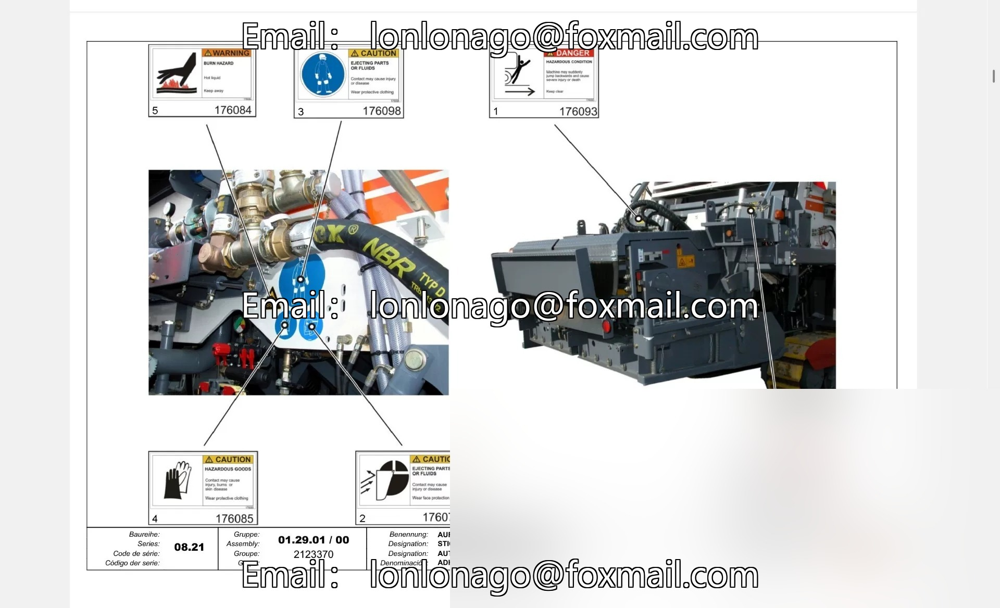
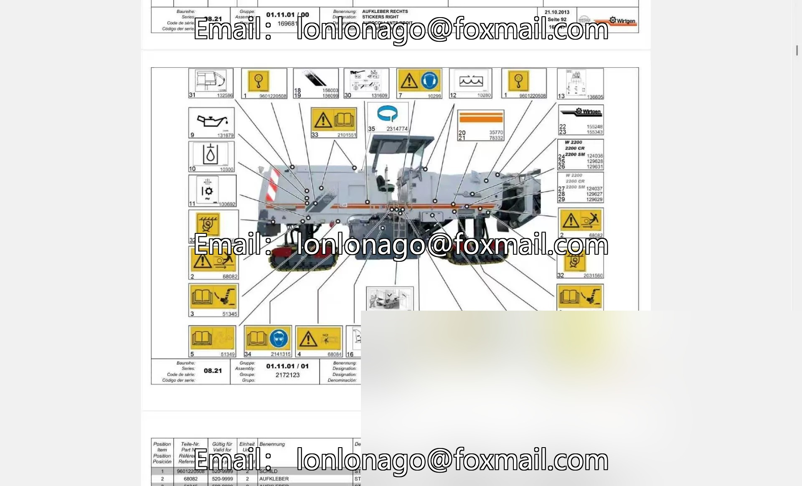
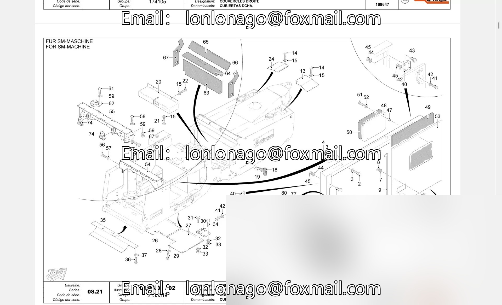
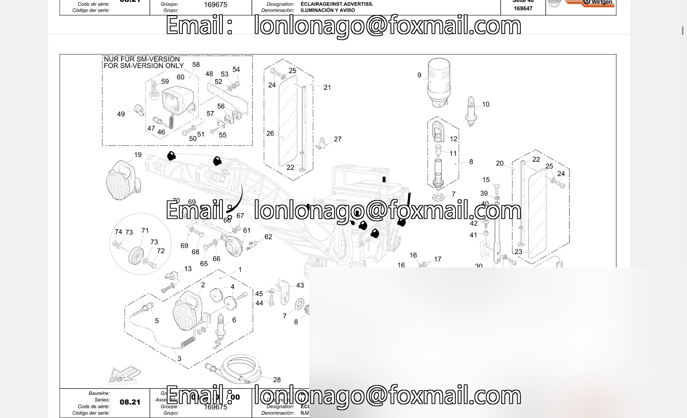

# Wirtgen W 2200 series cold milling/polishing machine official spares catalog

## Body

Wirtgen (Wirtgen) W 2200 series cold milling and sawing machine official parts directory
1300-page PDF
Includes lists of equipment components, systems, and accessories, suitable for maintenance, maintenance and parts procurement.
The materials are in , and are granted upon sale.
Brand: Wirtgen (Wirtgen), a globally leading manufacturer of pavement construction and repair equipment.

Model: Suitable for three types of large-scale cold milling machines: W2200, W2200 CR, and W2200 SM. These are heavy specialized equipment used for large-scale milling operations on high-grade roads, airport surfacing, and other applications.

This is the official spare parts directory for Wirtgen W 2200 series cold milling machine, listing parts, systems and accessory components for repair, maintenance and spare parts procurement, with the material offering no refunds.

<!-- AI_ENRICHED -->

## Images

## Payment

Here is a pay link on Stripe ( https://buy.stripe.com/3cs8yP7sY87d0vu9AB ). Please contact me lonlonago@foxmail.com after funding $89, and I will send you a complete data files , thank you!

